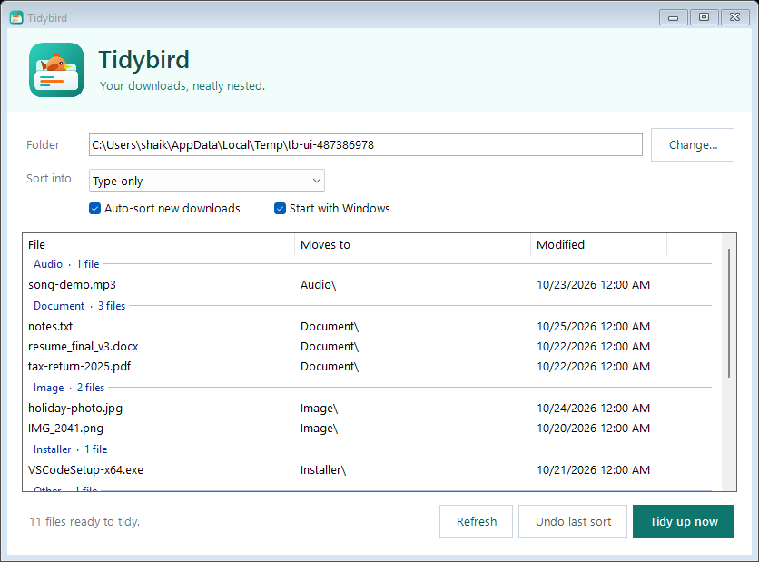

<p align="center"></p>

<h1 align="center">Tidybird</h1>
<p align="center">Your downloads, neatly nested.</p>

Tidybird is a small Windows app that sorts your Downloads folder by type,
for example `Image\photo.jpg` and `Zip\backup.zip`.



## Features

- **Preview** every file and where it will go before anything moves
- **Tidy up now** sorts in one click; **Undo last sort** puts files back, one run at a time
- **Auto-sort** new downloads about a minute after they finish, from the system tray
- **Start with Windows** (optional), hidden in the tray
- Sorts by type only by default; can optionally add month, year or day subfolders
- Never touches unfinished downloads (`.crdownload`, `.part`, `.tmp`), hidden files,
  files open in another program, subfolders, or its own exe
- Never overwrites: name clashes become `name (1).ext`
- Tiny: one ~60 KB exe, about 25 MB of memory, no install, no internet access

Folders: Image, Video, Audio, Document, Spreadsheet, Slide, Zip, Installer, Code,
Font, Torrent and Other. Edit them in `src/Sorter.cs`.

## Build

Needs only Windows (uses the C# compiler that ships with .NET Framework 4):

```powershell
powershell -ExecutionPolicy Bypass -File .\build.ps1
```

This writes `dist\Tidybird.exe` and `dist\Tidybird.ico`, and redraws `logo.png`.

## Test

```powershell
powershell -NoProfile -STA -ExecutionPolicy Bypass -File .\tests\Test-Tidybird.ps1
```

Tests run in temporary folders and never touch your real Downloads.

## Script version

`Sort-Downloads.ps1` does the same sorting from the command line, without the app:

```powershell
.\Sort-Downloads.ps1          # preview
.\Sort-Downloads.ps1 -Apply   # sort
.\Sort-Downloads.ps1 -Undo    # undo the last run
```

The app and the script share the same undo logs in `Downloads\.sort-logs`,
so either one can undo the other's sort.
